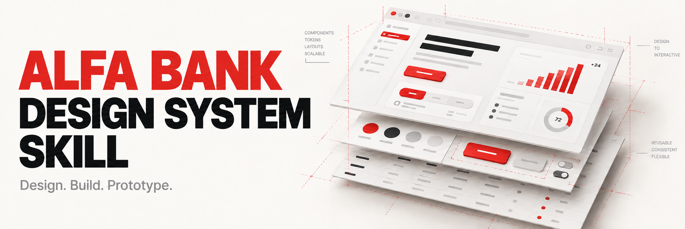
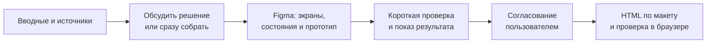

<p align="center">
  
</p>

<h1 align="center">Alfa Bank Design System Skill</h1>

<p align="center">
  <strong>Проектирование и сборка интерфейсов по дизайн-системе Альфа-Банка.<br>Редактируемые макеты в Figma, состояния, прототипы и HTML.</strong>
</p>

<p align="center">
  <a href="LICENSE"></a>
  
  
</p>

<p align="center">
  <a href="#быстрый-старт">Быстрый старт</a> ·
  <a href="#figma-lean-дополнительный-модуль-сборки">Figma Lean</a> ·
  <a href="#как-устроена-работа">Процесс</a> ·
  <a href="#источники-и-доступ">Источники</a> ·
  <a href="#статус-проверки">Что проверено</a> ·
  <a href="#частые-вопросы">FAQ</a>
</p>

---

**Переносимый неофициальный навык для Codex и Claude Code.** Помогает агенту
предлагать UX и композицию по продуктовой задаче, собирать новые макеты из
компонентов ДС, прорабатывать состояния и прототипы. После согласования макета
можно продолжить его реализацией в HTML. Пользователю не нужно
заново объяснять правила в каждой задаче или заранее приносить готовую композицию.

Результат предназначен для обсуждения с командой, проверки сценариев и передачи
разработчикам. Навык работает самостоятельно или внутри существующего процесса
работы с агентами; личная обвязка автора ему не нужна.

> **Статус:** выполнена одна практическая апробация сборки в Figma.
> Полный цикл Figma → HTML и выполнение в Claude Code пока не проверены.
> Апробация не означает согласования макета пользователем или готовности к выпуску.

## Для каких задач

| Задача | Что помогает получить |
|---|---|
| Спроектировать новый экран | UX и композицию на основе вводных, ДС и решений проекта |
| Собрать Figma | Редактируемые экраны с Auto Layout, библиотечными экземплярами и значимыми состояниями |
| Проверить сценарий | Прототип с необходимыми переходами и пояснениями к поведению |
| Доработать интерфейс | Правку нужной части с сохранением принятой композиции и защищённых исходников |
| Перенести дизайн в HTML | Рабочие взаимодействия и сравнение результата с согласованной Figma в браузере |
| Работать с продуктовой библиотекой | Сохранение её компонентов и связей с общей ДС |

Навык применяется, когда принадлежность интерфейса к Alfa DS установлена из задачи,
проекта или Figma. Для исследования и редактуры текста без работы с UI он
не подключается только из-за упоминания банка.

## Быстрый старт

### 1. Скачайте репозиторий

```sh
git clone https://github.com/Cartograf666/alfa-bank-design-system-skill.git
cd alfa-bank-design-system-skill
```

Если репозиторий недоступен вашей учётной записи, для клонирования понадобится доступ к нему.

### 2. Установите навык

Скопируйте папку `skills/alfa-bank-design-system` **целиком**, вместе с `references`
и `agents`. Имя репозитория — `alfa-bank-design-system-skill`; имя установленного
навыка и его вызова — **`alfa-bank-design-system`**.

| Среда | Личная установка | Для проекта, относительно его корня |
|---|---|---|
| Codex | `~/.agents/skills/alfa-bank-design-system` | `.agents/skills/alfa-bank-design-system` |
| Claude Code | `~/.claude/skills/alfa-bank-design-system` | `.claude/skills/alfa-bank-design-system` |

**Codex — личная установка**, из корня клонированного репозитория:

```sh
mkdir -p ~/.agents/skills
cp -R skills/alfa-bank-design-system ~/.agents/skills/
```

**Claude Code — личная установка**, из корня клонированного репозитория:

```sh
mkdir -p ~/.claude/skills
cp -R skills/alfa-bank-design-system ~/.claude/skills/
```

Для установки в проект скопируйте ту же папку в соответствующий каталог из таблицы.
Учитывайте уже имеющуюся копию, если вы меняли её инструкции.

Формат и пути сверены с документацией
[Codex](https://learn.chatgpt.com/docs/build-skills) и
[Claude Code](https://code.claude.com/docs/en/skills).

### 3. Дайте задачу

В **Codex**:

```text
$alfa-bank-design-system
Сразу собери экран настроек в Figma, без предварительного обсуждения.
Используй библиотеки текущего файла и вводные проекта.
```

В **Claude Code**:

```text
/alfa-bank-design-system
Сначала обсудим решение для экрана настроек по Alfa DS.
Изучи текущий макет и предложи структуру основного сценария.
```

Описание позволяет среде выбирать навык по контексту UI Альфа-Банка.
Фактический автовыбор зависит от поведения и настроек среды; ручной вызов явно
указывает нужный навык. Метаданные Codex разрешают неявное подключение.

## Что нужно для работы

Установка добавляет инструкции агенту. Создание и проверка артефактов требуют
соответствующих возможностей среды.

| Работа | Необходимая возможность |
|---|---|
| Изучить макет | Читать целевой Figma-файл, его библиотеки и материалы проекта |
| Собрать Figma | Редактировать целевой файл через доступную интеграцию или инструмент |
| Использовать корпоративную ДС | Иметь доступ к нужным библиотекам, вариантам, стилям и переменным |
| Сделать HTML | Читать и записывать файлы проекта |
| Проверить HTML | Открывать его в браузере, проверять вид и взаимодействия |

Основной навык работает самостоятельно. Дополнительный модуль `figma-lean`
использует официальный Figma-инструмент с `use_figma` и его текущую инструкцию.
Подходящие инструментальные навыки среды могут дополнять основной процесс.
Интеграции и разрешения не подключаются скрыто в ходе задачи.

Если операция недоступна, агент называет конкретный пробел и продолжает
поддерживаемую часть работы. Написанный HTML, открытый в браузере HTML
и созданный макет Figma отражаются в отчёте как отдельные результаты.

## Figma Lean: дополнительный модуль сборки

В репозиторий включена исправленная сборка **figma-lean**: готовые операции
Figma Plugin API, локальная карта файла и реестр найденных компонентов, стилей
и переменных. Основной навык выбирает UX и применимую ДС; помощник выполняет
повторяющиеся чтения и правки через официальный Figma-инструмент.

| Возможность | Практическая польза |
|---|---|
| Карта файла и адресное чтение | Найти нужную секцию и изучать отдельные узлы вместо повторного чтения всего файла |
| Реестр ассетов | Повторно использовать проверенные ключи компонентов и токенов |
| Короткие операции `fx` | Создавать экземпляры, копировать узлы, задавать свойства, применять стили и привязки |
| Явный родитель и область правок | Размещать новые элементы в нужном контейнере и проверять область helper-операций |
| Сохранение полных результатов | Получать компактную сводку, сохраняя полные данные и все изменённые ID локально |
| Рецепты и короткий QA | Повторно выполнять типовые операции и видеть ограничения структурной проверки |

Для модуля нужны **Node.js 18+**, официальный Figma-инструмент и доступ к файлу.
Он дополнительный: без него основной навык использует доступные средства среды.

<details>
<summary><strong>Подключить в Codex</strong></summary>

Из корня клонированного репозитория:

```sh
node integrations/figma-lean/install-codex.mjs
```

Установщик создаёт отдельный навык `figma-lean` в каталоге навыков Codex и
сохраняет предыдущую версию и рецепты в резервные копии. Рабочие данные находятся
в отдельном каталоге; разрешения, плагины и `config.toml` он не меняет.
Для обнаружения навыка может потребоваться новый чат.

```text
$alfa-bank-design-system $figma-lean
Сразу собери новый экран в Figma. Используй карту нужной секции и компоненты
подключённых библиотек; исходники сохрани, затем покажи макет и короткую проверку.
```

Codex использует программный мост, который собирает короткий вызов, выполняет
один официальный запрос и сохраняет полный ответ локально. Claude-hooks в эту
среду не переносятся.

</details>

<details>
<summary><strong>Подключить в Claude Code</strong></summary>

Сначала сохраните собственные версии `figma-lean` и рецептов, если они уже есть.
Из корня клонированного репозитория:

```sh
mkdir -p ~/.claude/skills ~/.claude/figma-lean/recipes
cp -R integrations/figma-lean/figma-lean ~/.claude/skills/
cp integrations/figma-lean/recipes/*.js ~/.claude/figma-lean/recipes/
```

В новой сессии подключите `/figma-lean`, затем дайте задачу с
`/alfa-bank-design-system`. Claude-версия использует hooks своего навыка,
объявленные в `figma-lean/SKILL.md`; процедура отличается от Codex.

</details>

Карта остаётся кэшем; при внешних изменениях нужен новый скан затронутой секции.
Scope проверяет helpers, но не изолирует произвольный Plugin API-код.
QA эвристический и не заменяет просмотр макета. Помощник не устраняет недоступность
Figma или блокировку обязательной инструкции, а измеренная экономия времени,
токенов и денег не заявляется. Рабочие выгрузки не включайте в репозиторий.

Порядок работы: [справка основного навыка](skills/alfa-bank-design-system/references/figma-lean.md).
Подробности модуля: [README](integrations/figma-lean/README.md).
Происхождение и границы лицензии: [THIRD_PARTY_NOTICES.md](THIRD_PARTY_NOTICES.md).

## Как устроена работа



**Начало.** Агент изучает доступные вводные, текущий макет, подписи, библиотеки
и принятые решения. Найденное не нужно объяснять повторно. В новой задаче он
спрашивает, **обсудить решение или сразу собирать**. Фраза «сделай экран» сама
по себе не выбирает режим; «сразу собирай, без обсуждения» выбирает.
В продолжении задачи и при локальных правках этот вопрос не повторяется.
Для сборки агент самостоятельно предлагает UX и композицию в рамках вводных и ДС.

**Figma.** Используются доступные компоненты, варианты, стили и переменные;
сохраняются редактируемость, Auto Layout и осмысленная структура. Состояния выбираются
по сценарию: загрузка, отсутствие данных, ошибка, выбор и другие необходимые случаи.
Поведение показывается через прототип и пояснения.

**Короткая проверка.** В задаче на сборку сначала появляется макет, затем
проверяются фактический вид, основной сценарий, редактируемость и сохранность
защищённых исходников. Пользователь получает ссылку на нужные фреймы
и существенные открытые вопросы.

**Длительный разбор.** Если проблемы требуют расширенного аудита, агент сначала
показывает текущий результат, объясняет влияние проблем и непроверенные места,
предупреждает о длительности и спрашивает, продолжать ли. Если оценка времени
неизвестна, это указывается прямо. Когда такой этап уже явно включён в поручение,
повторное разрешение не требуется.

**Согласование.** По основному процессу перед HTML агент ждёт согласования Figma
пользователем. Его собственная проверка или отсутствие замечаний не заменяют
согласование. Задача только на Figma заканчивается на макете.

**HTML.** Перенос сохраняет композицию, типографику, цвета, компоненты, состояния
и смысл интерфейса. Агент переиспользует существующую реализацию ДС в проекте
и делает необходимые взаимодействия работоспособными. Демонстрационные данные
и действия обозначаются, когда это влияет на оценку поведения.
HTML открывается в браузере и сравнивается с Figma на целевых размерах;
проверяются сценарий, состояния и загрузка нужного шрифта, исправляются расхождения.

Явный запрос может изменить последовательность или ограничить формат. Например,
ранний HTML для проверки гипотезы допустим по запросу пользователя и обозначается
как предварительный прототип. Наличие HTML не подтверждает готовность к выпуску.

## Вводные и результат

| Полезные вводные | Результат в пределах задачи |
|---|---|
| Продуктовая задача и основной сценарий | Предложенное UX-решение или собранный экран, в зависимости от выбранного начала |
| Целевой макет, библиотеки, тема и версия | Редактируемые фреймы на подтверждённых источниках ДС |
| Принятые решения и защищённые области | Доработка с сохранением согласованных свойств и исходников |
| Значимые состояния и целевые размеры | Состояния, прототип и проверки, соответствующие сценарию |
| Согласованная Figma и среда HTML | Интерактивный HTML и результат фактической проверки в браузере |

Не все вводные нужно приносить заново: сначала агент ищет их в доступных источниках.
Если чего-то существенного нет, он уточняет это или обозначает ограничение.

## Примеры задач

**Новое решение — начать с обсуждения**

```text
Нужен экран управления уведомлениями по Alfa DS. Сначала обсудим решение.
Изучи текущий файл Figma и вводные проекта; предложи основной сценарий
и значимые состояния.
```

**Сразу собрать Figma**

```text
Сразу собери в Figma экран заявки по дизайн-системе Альфа-Банка.
Используй подключённую продуктовую библиотеку и существующий набор иконок.
Исходные экраны сохрани; результат размести в новых фреймах.
После сборки покажи макет и короткую проверку.
```

**Локальная правка**

```text
Поправь состояния таблицы в текущем макете Alfa DS: пустой список
и ошибку загрузки. Сохрани согласованную композицию и остальные экраны.
```

**HTML по согласованной Figma**

```text
Макет согласован. Собери по указанным фреймам интерактивный HTML,
сохранив композицию и состояния. Используй принятый стек проекта.
Открой результат в браузере и проверь основной сценарий на целевых размерах.
```

**Без корпоративной библиотеки**

```text
Сразу собери предварительный макет по публичным источникам Core DS.
Корпоративная Figma-библиотека недоступна. Обозначь ограничения точности
и отличай локальные компоненты от официальных библиотечных экземпляров.
```

## Источники и доступ

**Основная точка отсчёта — целевой файл и решения проекта.** Агент определяет
применимые библиотеки, компоненты, варианты, стили, токены, тему и версию.
Локальный стиль или похожее название сами по себе не подтверждают принадлежность к ДС.

| Доступ | На что можно опираться | Граница точности |
|---|---|---|
| Корпоративная Figma доступна | Подключённые библиотеки файла и решения проекта | Соответствие проверяется для конкретных источников и версии |
| Только публичные источники | Документация Core DS; локальные компоненты по подтверждённым свойствам | Закрытые варианты и токены остаются неизвестными |
| Нет нужного инструмента | Поддерживаемая часть задачи | Создание или проверка недоступного артефакта не заявляются |

### Продуктовая библиотека и Core DS

У продукта может быть собственная библиотека поверх общей ДС. Навык выясняет,
какие компоненты продуктовые, какие приходят из общей библиотеки и какие стили
или переменные унаследованы. Источник экземпляров сохраняется: одинаковое
название не делает продуктовый и общий компонент взаимозаменяемыми.

Изменение источника требует проверки зависимостей и совместимости. Массовая
замена компонентов и обратная синхронизация не выполняются без соответствующей
задачи. Для локальной правки используется уже проверенная карта источников,
если её входные данные не изменились.

### Публичные ресурсы

| Ресурс | Для чего нужен |
|---|---|
| [Core Components — исходники и документация](https://github.com/core-ds/core-components) | Изучить публичные компоненты, свойства и реализацию |
| [Core Components — Storybook](https://core-ds.github.io/core-components/master/?path=/docs/intro--docs) | Посмотреть документированные компоненты и состояния |
| [Типографические переменные](https://github.com/core-ds/core-components/blob/master/packages/vars/src/typography-vars.css) | Проверить публичные значения и точное имя гарнитуры |

Ветка `master` меняется и не доказывает совпадения с установленной версией
или корпоративной Figma-библиотекой. Публичные React-компоненты не требуют
добавлять React в каждый самодостаточный HTML-макет.

Цвета, типографика и иконки берутся из подтверждённых источников с учётом роли,
темы и версии. Неоднозначные решения уточняются после изучения источников.
Набор иконок не подменяется произвольным похожим набором.

В публичном источнике `--font-family-alfasans` указывает на **Alfa Interface Sans**
(проверено 14 октября 2026 года). Имя в CSS не предоставляет файл шрифта или право
на распространение. Если нужный шрифт недоступен, точность типографики остаётся ограничением.

### Границы публичного комплекта

Основной навык содержит инструкции, ссылки на публичные источники и метаданные
Codex. Дополнительный `figma-lean` содержит код операций, установщик и тесты;
его происхождение и условия распространения описаны отдельно.
Корпоративные библиотеки Figma, токен-дампы, внутренние каталоги, фирменные шрифты,
иконки и материалы пользователя в него не входят. Доступные пользователю закрытые
материалы используются только в рамках его задачи.

Пакет не предоставляет доступ к организации Альфа-Банка. Недоступная библиотека
не подменяется другой ДС; работа продолжается по подтверждённым публичным источникам
с обозначением границ точности.

## Устройство репозитория

```text
alfa-bank-design-system-skill/
├── README.md
├── LICENSE
├── THIRD_PARTY_NOTICES.md
├── assets/
│   └── readme-cover.png
├── integrations/
│   └── figma-lean/             Дополнительный модуль для Codex и Claude Code
└── skills/
    └── alfa-bank-design-system/
        ├── SKILL.md
        ├── references/
        │   ├── alfa-rules.md
        │   └── figma-lean.md
        └── agents/
            └── openai.yaml
```

| Файл | Назначение |
|---|---|
| [SKILL.md](skills/alfa-bank-design-system/SKILL.md) | Проектирование, сборка Figma, согласование, HTML и самостоятельная работа |
| [alfa-rules.md](skills/alfa-bank-design-system/references/alfa-rules.md) | Источники ДС, цвета, типографика, иконки и доступ |
| [openai.yaml](skills/alfa-bank-design-system/agents/openai.yaml) | Необязательные метаданные Codex: название, описание, пример вызова и неявное подключение |
| [figma-lean.md](skills/alfa-bank-design-system/references/figma-lean.md) | Порядок использования дополнительного помощника и границы проверки |
| [integrations/figma-lean](integrations/figma-lean/README.md) | Библиотека операций, мост Codex, hooks Claude, рецепты, установщик и тесты |
| [LICENSE](LICENSE) | MIT для собственных материалов репозитория |

Обязательные инструкции находятся в `SKILL.md` и относительной справке
`references/alfa-rules.md`. `agents/openai.yaml` дополняет представление навыка
в Codex; другие среды используют инструкции навыка.

## Статус проверки

Срез на **14 октября 2026 года**. Формат пакета и практическое выполнение
проверяются отдельно.

| Проверка | Статус и свидетельство |
|---|---|
| Структура, метаданные и относительные ссылки | Проверены |
| Формат и пути установки | Сверены с документацией Codex и Claude Code |
| Переносимость публичного пакета | Проверено отсутствие персональных путей и корпоративных идентификаторов |
| Инструкции начала задачи и ограничения формата | Проверены на примерах старта, раннего HTML и отсутствия корпоративного доступа |
| Практическая сборка в Figma | Одна апробация: три редактируемых фрейма с библиотечными экземплярами |
| Сохранность защищённых исходников в апробации | Сравнение рендеров: 0 изменённых пикселей |
| Навигация прототипа в апробации | Пять переходов проверены кликами |
| Локальные тесты figma-lean | 36/36; проверки библиотеки, хранения, рецептов и моста с имитацией Figma API |
| Самопроверка figma-lean | 15/15 локальных проверок; живой вызов Figma этим не подтверждён |
| Согласование макета пользователем | Ожидается |
| HTML и полный цикл Figma → HTML | Не выполнены в апробации |
| Выполнение в Claude Code | Не проверено |
| Облачная синхронизация и исчерпывающая проверка скрытого контента на шрифты | Не подтверждены |

Эти результаты относятся к одной апробации. Они не подтверждают все версии
библиотек, сценарии, среды или соответствие любой продуктовой ДС.
Приватные макеты и корпоративные идентификаторы в документацию не включены.

## Частые вопросы

<details>
<summary><strong>Это официальный навык Альфа-Банка?</strong></summary>

Нет. Это неофициальный комплект инструкций. Он не заявляет одобрения
Альфа-Банка и не распространяет корпоративные материалы.

</details>

<details>
<summary><strong>Можно пользоваться без членства в организации Альфа-Банка?</strong></summary>

Да, по публичным источникам Core DS. Такая работа имеет ограничения точности
и не выдаётся за точное применение закрытой корпоративной библиотеки.

</details>

<details>
<summary><strong>Нужно ли заранее спроектировать экран самому?</strong></summary>

Нет. Агент может предложить UX и композицию по продуктовой задаче и доступным
вводным. Принятые решения и существующий макет при этом учитываются.

</details>

<details>
<summary><strong>Можно попросить только Figma или сразу HTML?</strong></summary>

Да. Явный запрос ограничивает формат или меняет последовательность.
Ранний HTML обозначается как предварительный прототип. По основному процессу
перенос в HTML начинается после согласования Figma пользователем.

</details>

<details>
<summary><strong>Почему агент спрашивает про обсуждение после «сделай экран»?</strong></summary>

В новой задаче навык различает обсуждение решения и непосредственную сборку.
Чтобы выбрать сборку сразу, напишите «сразу собирай, без обсуждения».
При продолжении и локальных правках этот выбор не спрашивается заново.

</details>

<details>
<summary><strong>Будет ли агент сразу проводить большой аудит ДС?</strong></summary>

В задаче на сборку сначала создаётся макет и проводится короткая проверка.
Если нужен длительный разбор, агент показывает результат и спрашивает о продолжении.
Для аудита, уже явно включённого в поручение, повторное разрешение не требуется.

</details>

<details>
<summary><strong>Навык устанавливает Figma-интеграцию и шрифты?</strong></summary>

Нет. Нужные инструменты и доступ предоставляются средой пользователя.
Инструкции не включают фирменные файлы шрифтов и не дают права на их распространение.

</details>

<details>
<summary><strong>Подойдёт ли результат для выпуска продукта?</strong></summary>

Макет и HTML служат обсуждению, проверке сценариев и передаче разработчикам.
Готовность к выпуску требует проверок конкретного продукта и не следует
из установки навыка или одной апробации.

</details>

## Как предложить улучшение

Создайте [Issue](https://github.com/Cartograf666/alfa-bank-design-system-skill/issues)
с задачей, средой, ожидаемым и фактическим поведением. Укажите этап расхождения
и приложите обезличенный пример, если это допустимо.

Для изменения инструкций предложите Pull Request с объяснением, какое поведение
он улучшает. Сохраняйте относительные ссылки, переносимость и различие публичных
и корпоративных источников. Сообщайте фактически выполненные проверки;
не называйте правку апробированной в среде, где она не запускалась.

Не добавляйте корпоративные файлы, токены доступа, закрытые ссылки или персональные
данные в Issue и Pull Request. При обновлении правил указывайте публичный источник
и версию либо дату проверки.

## Лицензия и иллюстрация

[MIT](LICENSE) распространяется на собственные инструкции и метаданные репозитория.
Условия использования материалов Альфа-Банка и других внешних источников
определяются их правообладателями и источниками.

В предоставленном архиве `figma-lean` отдельной лицензии нет. MIT основного навыка
этому модулю не назначается; перед его отдельным публичным распространением
нужно уточнить условия. См. [THIRD_PARTY_NOTICES.md](THIRD_PARTY_NOTICES.md).

Обложка создана с помощью генеративного ИИ для оформления репозитория.
Это иллюстрация, а не скриншот продукта или официальный макет Альфа-Банка.

**Проект не заявляет официального статуса или одобрения со стороны Альфа-Банка.**
